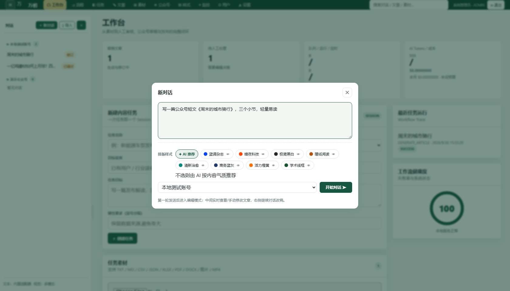
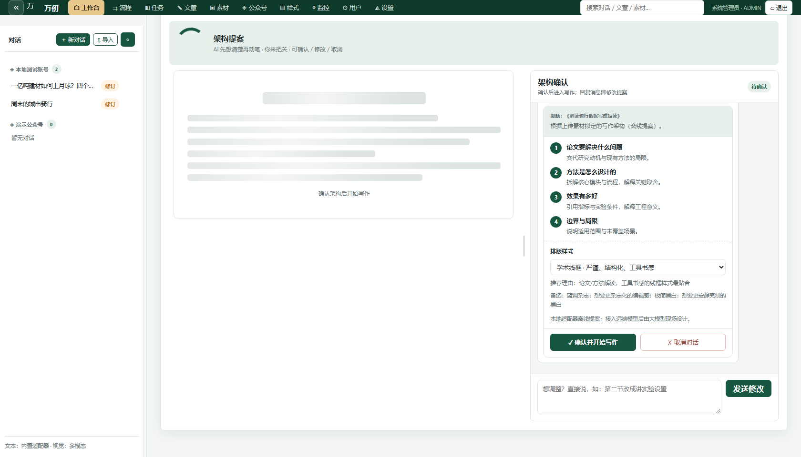
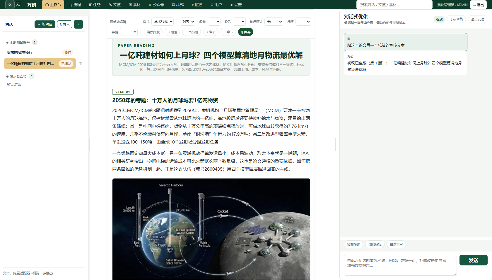
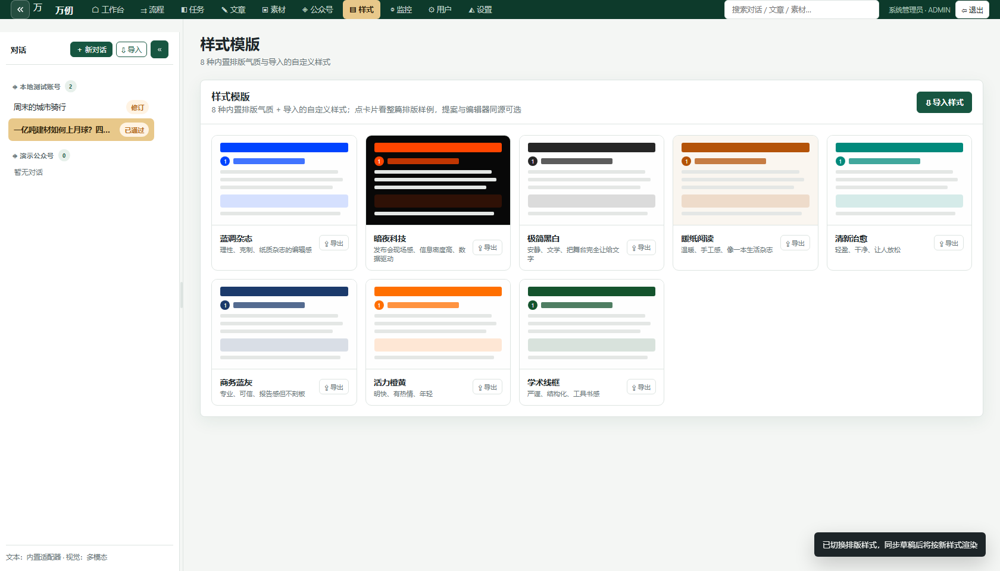
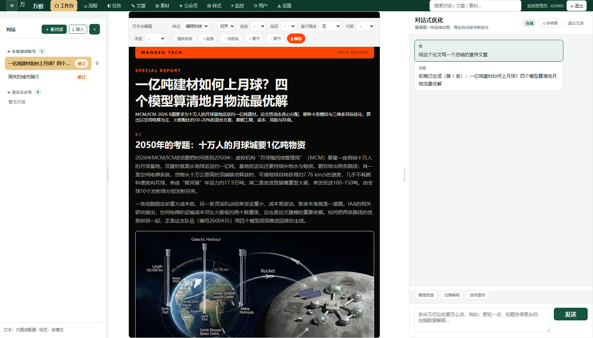
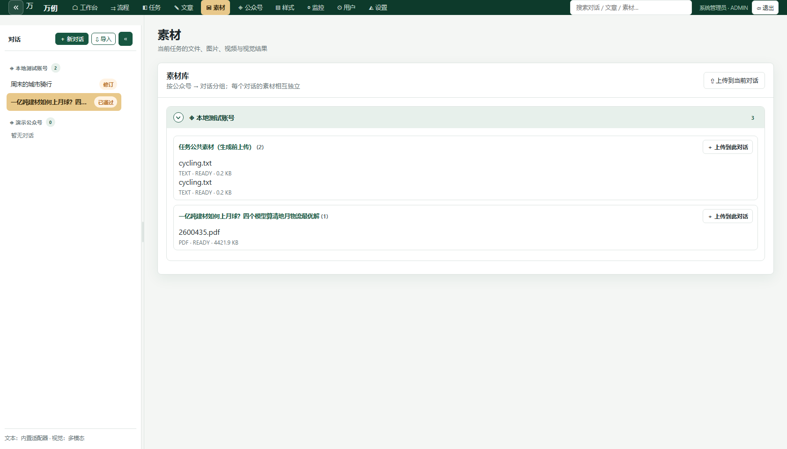
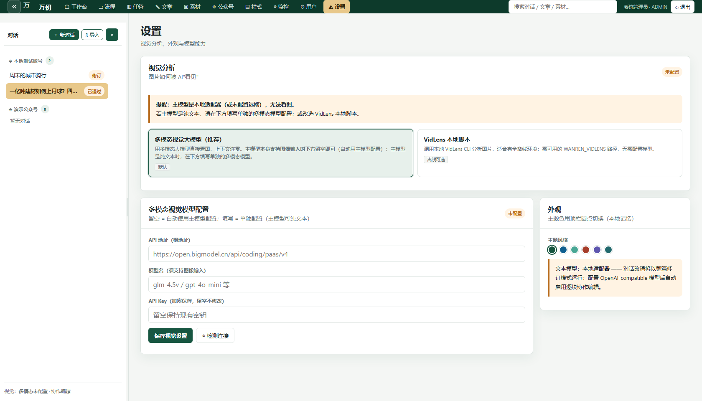
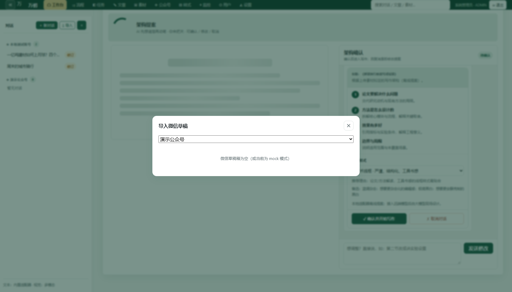
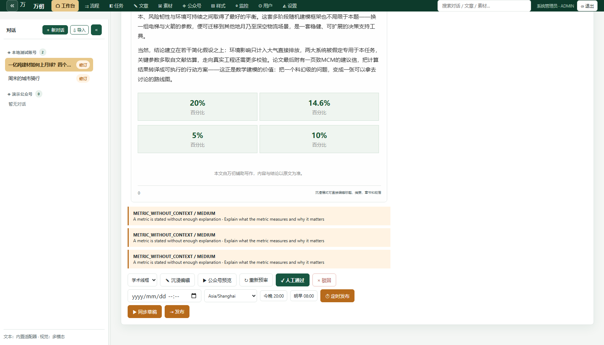

# 万仞 WanRen

**面向微信公众号的 AI 内容创作工作台** —— 上传素材，AI 先给大纲提案、你确认后再动笔；中间是与公众号同宽的所见即所得编辑器，右侧像聊天一样连续改稿，一键同步微信草稿与发布。

**[English](en.md)** | **简体中文** | **[完整使用手册](docs/使用说明.md)**

---

## 为什么是万仞？

- **先提案、后动笔**：AI 不直接开写——先读你的素材，给出拟题、逐节大纲与排版样式推荐，你确认或修改后才正式生成，返工成本前置为零
- **真·所见即所得**：编辑区固定 677px（与公众号正文同宽），字体、换行、指标卡、论文配图与发布后的文章完全一致；Ctrl+滚轮整体等比缩放，排版像素不漂移
- **发布 HTML 全内联**：8 种排版样式模版全部渲染为微信安全 HTML（无 flex/grid/渐变，深色页走 table 骨架），粘贴/同步到公众号不丢样式

## 能做什么

| 能力 | 说明 |
|---|---|
| 架构提案流 | 拟题 + 逐节大纲 + 样式推荐，确认 / 回复修改 / 取消 / 中途终止 |
| 8 种样式模版 | 蓝调杂志 / 暗夜科技 / 极简黑白 / 暖纸阅读 / 清新治愈 / 商务蓝灰 / 活力橙黄 / 学术线框；支持 JSON 导入自定义样式、导出分享 |
| 所见即所得编辑 | 直接在成品版式上改标题/摘要/章节/段落，中文排版工具栏（对齐/段距/缩进/行距/字距随发布转 inline CSS） |
| 对话式改稿 | 右侧面板连续对话，AI 通过工具逐块修改，你能看着它写；每轮可打断、可回退、改动黄色高亮回放 |
| 素材理解 | TXT/MD/CSV/JSON/XLSX/PDF/DOCX/图片/MP4；PDF 自动抽取论文配图并编号，指标自动提炼为数据卡 |
| 微信全链路 | 多账号管理、同步草稿（自动 draft/update）、导入外部草稿继续编辑、定时发布、发布状态回调 |
| 团队与运维 | 5 级角色分权（编辑/审核/发布）、AI 成本与预算、工作流监控、操作审计、6 套界面主题 |

## 界面速览

**① 新对话开局** —— 点「＋ 新对话」弹出居中输入框：写下想写的文章、拖入或粘贴素材（随首条消息一起发送）、选定排版样式与公众号。



**② 架构提案** —— AI 阅读素材后先给提案：拟题、逐节大纲（每节写什么）、推荐样式与理由。确认才开始写作；不满意直接在对话里说要怎么改。



**③ 编辑 + 对话（核心工作形态）** —— 中间是与公众号同宽的编辑区：样式版式、论文配图、指标数据卡全部实时可见、可直接编辑；右侧继续对话改稿。



**④ 样式模版画廊** —— 8 种气质整篇排版样例即时预览，一键复制到公众号编辑器；自定义样式支持 JSON 导入 / 导出。



**⑤ 沉浸编辑与中文排版** —— 深色画布上直接编辑，工具栏提供对齐 / 段前 / 段后 / 首行缩进 / 行距 / 字距，参数随发布原样带到公众号。



<details>
<summary>查看更多界面：素材库、模型设置、草稿导入、发布面板</summary>

**⑥ 素材库（两级归属）** —— 按「公众号 → 对话」折叠分组，每个对话的素材相互独立；图片视觉分析结果折叠展示。



**⑦ 模型设置** —— 主文本模型（OpenAI 兼容）、视觉模型、VidLens 离线脚本三处独立配置，密钥加密存储，带一键连通检测。



**⑧ 微信草稿导入** —— 外部草稿一键导入为对话，AI 解析结构后继续改稿，再同步回同一条草稿。



**⑨ 审核与发布** —— AI 规则预审 + 人工终审 + 原创声明确认，同步草稿 / 定时发布 / 发布状态一目了然。



</details>

---

## 快速开始（Docker，推荐）

需要 Docker 20+ 与 docker compose v2。

### 1. 准备配置

```bash
git clone https://github.com/francis20060728-jpg/WanRen.git
cd WanRen
cp .env.example .env
```

编辑 `.env`，按需填写（默认值即可启动）：

```dotenv
# 应用加密密钥：用于加密存储在数据库里的模型 API Key
# 生成一次即可；生产环境必填，更换会使已保存的 Key 失效
WANREN_APP_SECRET_KEY=<openssl rand -hex 32 的输出>
```

> [!IMPORTANT]
> `WANREN_APP_SECRET_KEY` 设置后**不要更换**：数据库里的模型 API Key 用它加密，换密钥意味着已保存的 Key 全部需要重新录入。

### 2. 构建并启动

```bash
docker compose up -d --build      # 首次构建约 1-3 分钟
docker compose ps                 # api 与 worker 都应为 healthy/running
docker compose logs -f api        # 看到 Uvicorn running 即就绪
```

浏览器打开 **http://127.0.0.1:8000**，默认开发账号：

| 项 | 值 |
|---|---|
| 邮箱 | `admin@wanren.local` |
| 密码 | `wanren-dev-admin` |

> [!IMPORTANT]
> 这个默认密码只存在于 `WANREN_AUTH_MODE=dev`（默认）。**对外部署请改生产模式**：`.env` 里设置 `WANREN_AUTH_MODE=production`、`WANREN_ADMIN_PASSWORD=<强密码>` 与 `WANREN_APP_SECRET_KEY`（后两项生产模式缺一不可，否则拒绝启动）。

默认 `WANREN_PUBLISHER=mock`：内置一个本地测试公众号，无需任何微信凭证即可体验全流程（生成、编辑、假发布）。

### 3. 停止 / 升级 / 备份

```bash
docker compose down          # 停止（数据保留在 wanren-data / wanren-storage 卷里）
docker compose up -d --build # 升级：重新构建镜像并启动，数据不丢
docker compose down -v       # ⚠️ 危险：会删除全部文章与素材数据
```

备份数据即备份两个卷（SQLite 数据库 + 素材文件）：

```bash
docker run --rm -v wanren_wanren-data:/data -v "$PWD:/backup" alpine \
  tar czf /backup/wanren-data-$(date +%F).tar.gz -C /data .
```

---

## 首次部署后的配置顺序

### 第一步：改管理员密码

生产模式已由 `.env` 的 `WANREN_ADMIN_PASSWORD` 控制。开发模式下可在「用户」页创建自己的账号后停用默认账号。注册开关由 `WANREN_REGISTRATION_ENABLED` 控制（生产默认关闭）。

### 第二步：接入模型

进入「设置」页配置主文本模型（任何 OpenAI 兼容接口）：

1. **提供商**选 `openai_compatible`
2. **API 地址**填根地址（如 `https://open.bigmodel.cn/api/coding/paas/v4`），**不要**手动加 `/chat/completions`
3. **模型名**与 **API Key** 填当前服务商的值
4. 点「◎ 检测连接」验证，保存（密钥加密入库，页面上永远只显示脱敏形式）

视觉分析两种模式：「多模态大模型」（主模型支持图像则留空自动复用）或「VidLens 本地脚本」（完全离线）。也可以全部用环境变量预置（`WANREN_TEXT_*`），页面配置优先于环境变量。

### 第三步：连接微信公众号

> 前置说明：默认 `WANREN_PUBLISHER=mock` 只会假发布。**接真实公众号必须两步走：改发布模式 + 配凭证。**

**① 开启真实发布模式** —— `.env` 中：

```dotenv
WANREN_PUBLISHER=wechat
```

然后 `docker compose up -d` 重启生效。

**② 在微信公众平台获取凭证** —— 登录 [mp.weixin.qq.com](https://mp.weixin.qq.com)：

1. 左侧「设置与开发 → 基本配置（公众号信息）」可查 **AppID**
2. 同页「开发者密码」处生成/查看 **AppSecret**（首次需扫管理员二维码启用；忘了只能重置）
3. **把部署服务器的公网出口 IP 加入 IP 白名单**：「设置与开发 → 基本配置 → 公众号开发信息 → IP 白名单」。不加白名单，所有接口调用都会报 `errcode 40164 invalid ip`

**③ 在万仞里添加账号** —— 「公众号」页 → 新增公众号：填名称与 AppID，保存后点「检测连接」。AppSecret 不直接填在页面上，而是放进 `.env` 的专属环境变量（避免入库）：

```dotenv
WECHAT_APP_SECRET_<大写AppID>=<该公众号的AppSecret>
```

多账号同理：每个账号只存 AppID，各自的 Secret 用 `WECHAT_APP_SECRET_<APPID>` 引用。

**④ 个人主体公众号注意** —— 个人订阅号没有「发布」API 权限（`errcode 48001`）：万仞仍可正常**同步草稿**，最后一步发布请在公众号后台手动点击。

（可选）需要发布状态回调时，把 `https://你的域名/wechat/<账号ID>/callback` 配到公众号「基本配置 → 服务器配置」，并在 `.env` 设 `WANREN_WECHAT_CALLBACK_TOKEN`。

### 第四步：完成第一篇文章

1. 「＋ 新对话」→ 输入想写的主题，拖入素材（PDF/图片/文档），选一个排版样式，发送
2. 等 AI 读素材并给出**架构提案**——直接确认，或回复修改意见（例如「扩成 6 节」）再确认
3. 生成完成后自动进入「中间编辑 + 右侧对话」：中间直接改正文，右侧继续说「第二段加一个数据卡」这样改
4. 满意后「✓ 人工通过」→「▶ 同步草稿」→ 到公众号后台预览（**草稿必须带封面图**：在对话里上传任意图片即可）→ 发布或回万仞点「⇥ 发布」

### 第五步（可选）：定时发布与团队协作

- 「⏱ 定时发布」支持时区选择，到点自动发布（也可用「今晚 20:00 / 明早 08:00」快捷按钮）
- 「用户」页创建编辑 / 审核 / 发布分权账号；「监控」页看队列、工作流轨迹与操作审计

---

## 生产环境部署

在快速开始基础上叠加生产覆盖层（只读根文件系统、丢弃全部 capabilities、禁止提权、CPU/内存限额、production 认证模式）：

```bash
docker compose -f docker-compose.yml -f compose.prod.yml --env-file .env up -d
```

建议再做三件事：

1. **HTTPS 反向代理**：用 Nginx / Caddy 把域名指向容器的 8000 端口（微信回调与网页登录都需要 HTTPS）
2. **数据备份**：定期备份 `wanren-data` 卷（上一节的 tar 命令）
3. **密钥管理**：`.env` 不入库不入镜像；`WANREN_APP_SECRET_KEY` 与 `WANREN_ADMIN_PASSWORD` 使用密码管理器保存

## 关键环境变量

| 变量 | 作用 | 生产建议 |
|---|---|---|
| `WANREN_PUBLISHER` | `mock`（本地假发布）/ `wechat`（真实公众号） | `wechat` |
| `WANREN_AUTH_MODE` | `disabled` / `dev` / `production` | `production` |
| `WANREN_ADMIN_EMAIL` / `WANREN_ADMIN_PASSWORD` | 引导管理员账号 | 强密码，必填 |
| `WANREN_APP_SECRET_KEY` | 加密落库 API Key 的应用密钥 | `openssl rand -hex 32`，设后勿换 |
| `WANREN_TEXT_PROVIDER` | `local`（离线演示）/ `openai_compatible` | `openai_compatible` |
| `WANREN_TEXT_MODEL` / `WANREN_TEXT_API_BASE` / `WANREN_TEXT_API_KEY` | 主文本模型三件套 | 支持任何 OpenAI 兼容服务 |
| `WANREN_VISION_PROVIDER` | `multimodal` / `vidlens` | 按视觉方案选择 |
| `WANREN_REGISTRATION_ENABLED` | 是否开放注册 | `false` |
| `WANREN_MAX_UPLOAD_MB` | 单文件上传上限（默认 20） | 按需 |
| `WANREN_WORKFLOW_MODE` | `inline`（同步）/ `background`（队列） | `background` |
| `WECHAT_APP_SECRET_<APPID>` | 各公众号 AppSecret（不入库） | 每账号一个变量 |
| `WANREN_WECHAT_CALLBACK_TOKEN` | 微信回调签名 Token（可选） | 启用回调时设置 |

完整清单见 `.env.example`（每项都有注释）。

## 从源码运行

需要 Python 3.13+：

```bash
pip install -r requirements.txt
pip install pytest                              # 测试
python -m uvicorn wanren.app:create_app --factory --port 8000
```

数据默认落在 `./data/wanren.sqlite3` 与 `./storage/`（`WANREN_DB_PATH` / `WANREN_STORAGE_PATH` 可改）。

## 测试

```bash
python -m pytest -q     # 197 个测试：真实 HTTP 层，含假微信服务器与完整发布链路
```

## 安全与运维提醒

- `.env` 含密钥，**绝不提交**（`.gitignore` 已排除）
- 数据库与素材都在 Docker 卷里，升级前先备份
- 模型 API Key 建议只通过设置页或环境变量录入，页面上永远只显示脱敏形式
- 先「同步草稿」在微信后台预览，确认无误再发布——保留人工终审边界

## 常见问题

| 现象 / 报错 | 原因与解决 |
|---|---|
| 同步草稿「成功」但公众号里没有 | `WANREN_PUBLISHER` 还是 `mock`（本地假发布）。改为 `wechat` 并重启 |
| **errcode 40164 invalid ip** | 服务器公网 IP 不在微信白名单。「公众平台 → 设置与开发 → 基本配置 → IP 白名单」加入后重试（见第三步②） |
| **errcode 48001 api unauthorized** | 个人主体公众号没有发布接口权限。正常用「同步草稿」，发布在公众号后台手动点 |
| 检测连接显示 `MOCK_MODE` | 同上：当前是 mock 发布模式，未真正连微信 |
| `缺少封面图：请先在对话中上传一张图片…` | 微信草稿必须带封面。在对话中上传任意图片（自动作为封面） |
| 模型连接失败 / 生成报 HTTP 4xx | 「设置」页用「◎ 检测连接」验证地址/Key/模型名；API 地址只填根地址，不要带 `/chat/completions` |
| 视觉分析无结果 | 多模态模式需主模型支持图像或单独配置视觉模型；VidLens 模式需其内部模型可用 |
| 协作编辑变慢/降级提示 | 主模型为本地适配器时自动降级为整篇修订；接入远端模型恢复逐块编辑 |

## 架构与文档

```
FastAPI + SQLite(WAL) 单体后端 ── SSE 流式 ── 零构建原生 JS 前端
        │                                │
        ├─ 文本: OpenAI 兼容适配器(流式)      ├─ 对话工具循环(浏览器执行)
        ├─ 视觉: 多模态 API / VidLens 子进程   ├─ 版本链 + 高亮 diff + 回退
        ├─ 队列: BEGIN IMMEDIATE 原子认领      └─ 8 种排版样式全内联渲染
        └─ 微信: stable_token 缓存/幂等键/回调去重/定时发布
```

- **[完整使用手册](docs/使用说明.md)** —— 每个界面、每条流程的逐步说明与注意事项

## 目录

```
wanren/       后端（service / publishing / assets / review / crypto …）
static/       前端（单页，零依赖）
tests/        pytest 测试套件（真实 HTTP 层，含假微信服务器）
scripts/      内置工具（VidLens 离线视觉脚本）
docs/         使用手册 / 架构 / 开发指南
screenshots/  界面截图
```

## 许可

本项目采用 **[万仞个人使用许可](./LICENSE)**：允许个人学习与非商业使用；**禁止任何商业用途与有偿转售/二次分发**。

---

<p align="center">万仞 WanRen · 2026</p>
